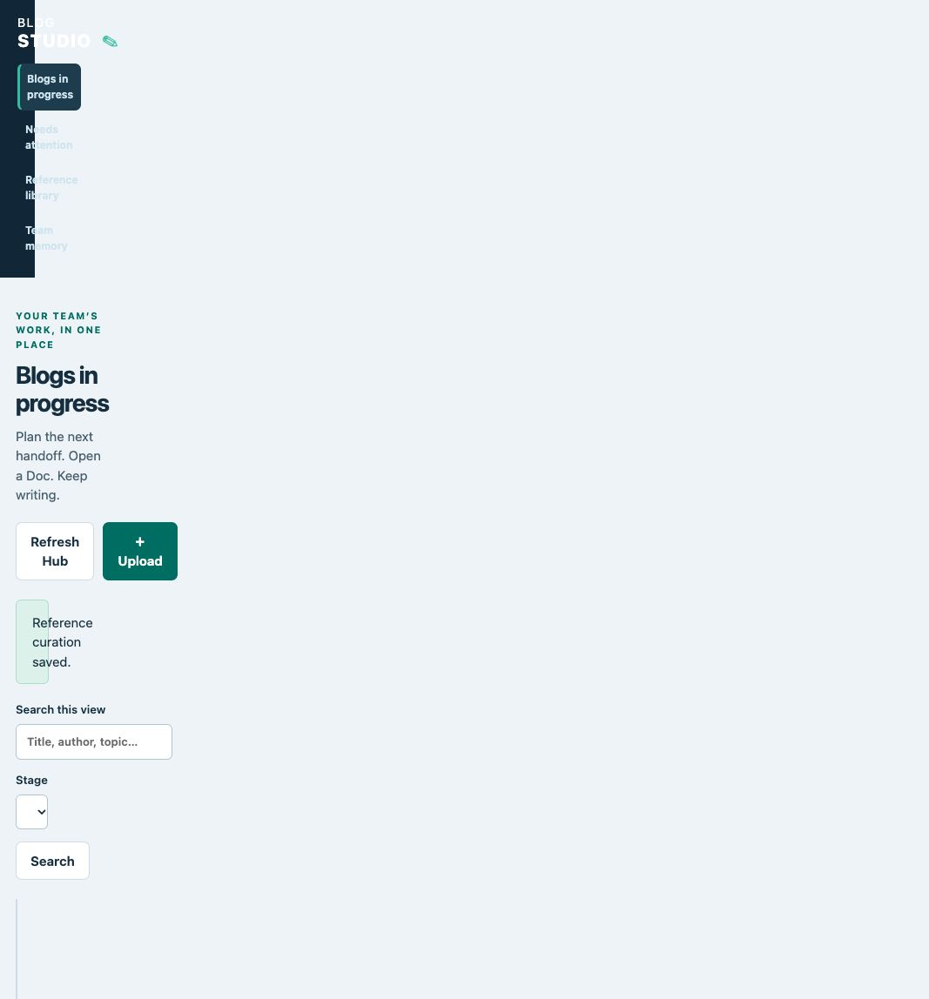

# Your editorial desk



*Sample content; your desk shows your selected workspace and Team Hub.*

[See the phone layout](assets/editorial-desk-phone.png).

In Codex or Claude Code, say **“Use Blog Studio. Open editorial desk.”**
The page opens on your computer against your current writing workspace and
selected Team Hub. Keep the helper running while you use the page.

## Pick up a blog or finding

Open a blog title to see a saved manuscript preview or working Google Doc link,
review freshness, and the next available action. Choose **Copy request**, then
paste into your Codex or Claude Code chat. The request identifies the exact blog
and keeps its requested stopping point. If copying is unavailable, select and
copy the text yourself.

Choose **Inspect finding** in **Needs attention** to open that finding with its
blog and saved evidence. Search this view by blog, finding text, kind, or status.
A finding that changed since the list loaded asks you to reload the inbox.

**Editorial details**, **Reviews and freshness**, and **Evidence and history**
open only when you need them. A changed manuscript explains why an earlier ready
or published decision is no longer current. Shared reviews are saved snapshots;
resume in chat to check them against your current local inputs. No action here
approves or publishes a blog.

On phones and tablets, results become stacked rows with title, stage/status,
owner/due information and actions visible without sideways scrolling. Wider
screens keep the table. Dialogs scroll internally with visible Close and Save
controls.

## What you can do

**Blogs in progress** shows titles, authors, owners, due dates, editorial stages,
and saved working Google Doc links. Open a local blog to assign an owner, choose a
due date, or record a stage. Choose **Resume** on a shared blog to bring its saved
revision into your workspace. Existing unshared edits are protected.

Saving sends only what you changed. Changing an owner, date or URL leaves the
stage alone, and never renews a ready or published decision made for an earlier
draft. To record **ready** or **published**, choose it and check the box that
says the decision is for the current saved draft; the same box renews a decision
after the draft changed. **Follow writing progress** removes an explicit stage,
so the board shows where the writing actually is.

**Needs attention** collects saved review findings, stale checks/companions,
waiting questions and sharing problems. Ask in chat to refresh Google feedback
for your selected blog. Viewing an inbox does not apply or accept an edit.

If a blog's saved record cannot be read, both lists still show every other blog
and name the one that could not be read. Ask Blog Studio in chat to inspect it.

**Reference library** lets you search saved sources, read a bounded excerpt, add
topic/product tags, and mark a reference active, pending, or retired. Retirement
keeps earlier Git versions. Dated product claims need current verification.
Only a tag or note you actually change counts as your correction; saving a note
does not stop automatic tags from being added later.

**Upload** accepts Markdown, text, HTML, DOCX and PDF. Originals remain saved.
PDFs need text extraction in chat. Check **Start an editable blog** only when you
want a manuscript; an ordinary reference upload does not start a new blog. A
DOCX that cannot be opened is refused with a message; nothing is saved from it.

**Team memory** lets you read and save notes, context and writing rules. Choose
whether a memory applies to the team, a project, an author, or one blog. Changes
create revisions; existing blogs keep their selected context until deliberately
updated. Editing sends only the fields you changed, and a long memory keeps the
text beyond the part shown unless you change the text. Decisions are read-only
here; inspect them and discuss a follow-up in
chat. Collection settings and candidate lessons also show read-only details and
a focused continuation, without a generic Save that could change their type.

## What leaves your computer

Files you upload or import are saved in your workspace and your selected private
Hub. Reference analysis is separate and optional. When an analysis CLI (Codex or
Claude) is saved for the workspace, text from each readable file, up to 24,000
characters, is also sent through that signed-in CLI to its model provider to
create a summary and tags. The access panel says which CLI is saved, or that
analysis is off. Each upload and each import batch has a **Summarize and tag
with …** checkbox, checked by default; uncheck it and that file or batch is saved
without being sent. **Analyze reference** sends one reference when you ask.
Opening the desk never turns analysis on; see the launch section below.

## Bring in your earlier blogs

In the desk, open **Reference library → Import old blogs**. Choose a folder on
this computer, a website, an RSS/Atom feed, or a JSON export. Give the collection
a name; for web sources, choose the website/path containing the permitted posts.
Sitemaps and a list of post links are also supported. A website preview lists
links on that page; it does not follow the rest of an archive automatically.
Feeds may list only recent posts, and sitemap indexes are not expanded. The
preview explains this coverage before you import.

Click **Preview blogs** to see every candidate with a checkbox, label and URL.
Nothing is selected automatically. Check only actual posts; author profiles,
category pages and navigation links may also appear. **Select all** and **Clear
selection** are available. Click **Import selected…** to save up to 25 checked
posts. Remaining checkmarks are retained for the next batch; unchecked pages
are never fetched. The result shows added, updated,
unchanged, failed, and pending-extraction posts, plus whether the Hub save succeeded.
You can reload a saved preview, check failed posts to retry, or select **Refresh an existing
collection**. Closing and reopening the desk retains the latest import checkpoint.

A new collection is saved, and shared with your Hub, when you import its first
posts. A preview that fails or that you close leaves no collection behind, so
you can correct the address and use the same name again. To pick up new or
changed files in a folder or export you chose here, select **Refresh an existing
collection** and choose the folder or file again; leaving it empty re-checks the
earlier selection. A post already saved is updated, not copied, even when the
folder was renamed or the same file is imported into another collection.

The browser folder/export picker accepts up to 500 supported files and 10 MiB
in total. For a larger local folder, use the chat command. A JSON export is a list
of objects with `title`, `text`, and `url` or `external_id`; author, dates and tags
are optional. Ordinary uploads remain available for single references or drafts.

You can also say **“Import our old blogs from [folder, feed, website, or export].”** Blog Studio
asks for a collection name and any missing scope details, then previews posts,
exclusions and limits before importing. A refresh uses the same preview-and-batch
approach. It preserves originals, metadata and earlier versions, and reports
partial failures. Missing or unreadable posts are not counted as read or deleted.

Use **“Find our previous blogs about [topic]”**, then **“Use these as references.”**
Only selected passages enter the writing conversation. **“Learn from our old
blogs”** produces candidate observations and recommendations with supporting
passages; a candidate becomes a shared writing rule only by explicit choice.

## Work in chat, browse in the desk

Say **“Show evidence”** to inspect support for important claims, **“This needs a
diagram”** for a visual companion, or **“Package this for launch”** to prepare
selected channel copy. Companions record their input draft and sources and become
stale when those inputs change. Preparing them does not publish anything.

## Access and sharing

There is one contributor level. Everyone with existing Hub write access can use
the editing controls; GitHub repository admins manage membership. The access
message distinguishes a local workspace, write access, read-only access, expired
sign-in, and unavailable verification. **Check access** checks again before you
fill out an editing form. Read-only members can still browse saved records and
use **Refresh Hub**; editing controls are unavailable with an explanation.
Under the access message the desk names the workspace folder and Team Hub it is
showing, and the analysis CLI saved for this workspace.

Every actual write checks current access again. If access cannot be verified,
check your sign-in and repository permissions; ordinary chat saves still retain
local work. Access observations do not grant permissions or create another role.

**Refresh Hub** checks shared Git changes. It does not refresh Google Docs.
Google links are saved working links, not proof the document is current. Use
**“Pull from Google Docs”** or request a live feedback refresh in chat.

The desk runs on your computer, not as a shared website. The private Hub's
homepage links generated **Editorial board** and **Reference collections** pages
when those features are used and synced. Work waiting for a contribution review
has not reached main. Ordinary GitHub Pages would make the content public;
private Pages requires an organization with GitHub Enterprise Cloud. This release
does not deploy Pages or introduce another account.

## Developer / support launch

The harness uses the installed interpreter and runtime:

```sh
python3 /path/to/runtime/studio.py --root /path/to/writing/.blog-studio manage
```

Open the exact returned local session URL. The process stays running until
Ctrl+C. The session URL is for your local browser; do not share it as a team link.

Opening the desk does not change whether references are analyzed. Add
`--harness codex` or `--harness claude` to save that signed-in CLI as the
workspace's analysis CLI; only that explicit flag saves a choice. The launch
output includes an `analysis` note saying what was saved, what was already
saved, or that analysis is off.

The desk answers each browser connection separately, so a slow or silent
connection does not hold up the page. Changes to your workspace still happen one
at a time: while a long import or analysis runs, another desk action reports
that an operation is still running and changes nothing.

Save feedback distinguishes local retention, shared work and contribution review. A persistent sharing panel lists retained operations that still need attention. Use **Retry sync** for that checkpoint; it does not repeat an upload or memory edit. Errors stay in the open dialog so you can correct or reload without losing your entry.

## When a reference changes while you edit

Blog Studio keeps your proposed tags and notes and stops the save. Choose
**Reload and compare** to see the latest saved values beside your proposal. Then
choose **Use latest saved values** or **Keep my proposal for resubmission**, review
the form, and choose **Save curation**. Reloading alone does not write anything.
If the reference has unshared local edits, compare them in your chat first.

Changing views, searches or pages cancels older list requests. The loading message
marks the pending view; page buttons are disabled until it finishes. If loading
fails, the previous valid results remain visible.

When an analysis CLI is saved and **Summarize and tag** stays checked, readable
uploads and imports are analyzed: Blog Studio adds a summary, topics, product
tags and cautions for later reuse. **Review details** lets you correct those
results; **Analyze reference** runs analysis that was skipped or did not finish.
Your originals are retained. Analysis uses your saved signed-in Codex or Claude
CLI and sends it up to 24,000 characters per file, as described under
[What leaves your computer](#what-leaves-your-computer). PDFs without extracted
text remain marked **Needs extraction**.

Developer verification: [import-time curation checks](reference-curation-validation.md).
